# SmartSurplus

**Food-surplus forecasting and constraint-aware NGO recommendations.**

SmartSurplus is a capstone research prototype for food providers, NGOs and network administrators. It combines preparation records, experimental surplus estimates, reported recipient availability and a web interface for examining redistribution options.

The project addresses two separate questions:

1. **How much food may remain unserved?** Compare nonlinear forecasting models using information available before service ends.
2. **Which NGO can receive a confirmed donation?** Check capacity, food compatibility, handling and timing before ranking eligible registered NGOs.

> **Evidence scope:** the principal surplus and NGO matching experiments use synthetic data. Measured school-waste and parcel-time benchmarks are separate experiments with different targets. Predictions support review; they do not certify food safety or guarantee receipt. The screenshots below are genuine captures of the running local application, not generated mockups.

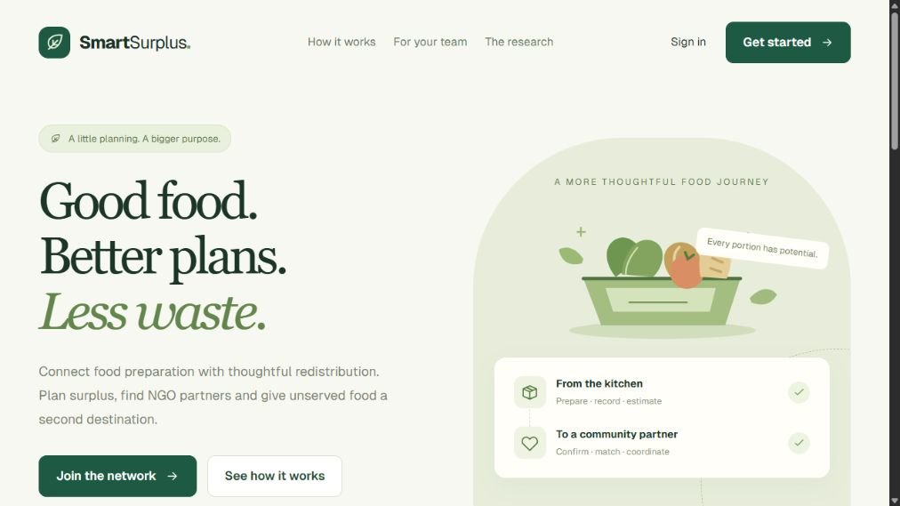

## Contents

- [Project status and version scope](#project-status-and-version-scope)
- [Features and roles](#features-and-roles)
- [Architecture](#architecture)
- [Use-case diagram](#use-case-diagram)
- [Processing blocks and data flow](#processing-blocks-and-data-flow)
- [Modules and source map](#modules-and-source-map)
- [Models and datasets](#models-and-datasets)
- [Formulas and their implementation](#formulas-and-their-implementation)
- [Evaluation results](#evaluation-results)
- [Real browser demo](#real-browser-demo)
- [Installation and configuration](#installation-and-configuration)
- [API guide](#api-guide)
- [Testing and reproducibility](#testing-and-reproducibility)
- [Scope and future development](#scope-and-future-development)
- [Team and references](#team-and-references)

## Project status and version scope

This README describes the **full local capstone workspace inspected on 1 November 2026**. The screenshots were captured from that workspace, using ChatGPT's built-in browser at `http://127.0.0.1:3000` and a local FastAPI server on port 8000.

There are several distinct model pipelines. Their input counts, targets and results must not be combined:

| Pipeline | Inputs | Target | Integration |
|---|---:|---|---|
| Operational catalog surplus | 20 | Synthetic catalog `surplus_kg`, recorded as post-reuse/pre-disposal | Current local food-entry and prediction pages; saved LightGBM text model |
| Paper surplus experiment | 46 | `actual_unserved_surplus_kg` for an item-service | Separate offline RF/LightGBM research experiment |
| NGO recommendation | 28 numeric model features, plus request fields used in gates | Received fraction and elapsed minutes | Saved RF/LightGBM models used by the local registered-NGO page and research lab |
| Finnish school benchmark | 14 | Combined kitchen and serving waste, kg/day | Separate measured-waste research page |
| Parcel-time benchmark | 9 | Task acceptance-to-completion minutes | Separate offline experiment; not the live travel estimator |

**Publication checkout difference:** GitHub `main` at the previously published commit `a36deab` contains the role UI, frozen research services and registered-NGO recommendations, but its basic surplus/analytics service is an older demonstration implementation. The full local workspace adds the 20-input saved surplus model, catalog API, empty initial prediction/match stores and receipt-based analytics. Documentation and screenshots do not silently deploy these additional local code changes. Check the code/version you are running before reproducing an operational screenshot.

The older publication surplus implementation trains against demo-derived labels and generates random confidence values. Those outputs are not valid research results. In the current local implementation, inference loads a saved model, `confidence` is `null`, and an empirical validation-error interval is shown only when required history is complete.

## Features and roles

| Role | Implemented actions | Main screens |
|---|---|---|
| Provider | Record preparation, run saved surplus inference, inspect estimates, confirm an offer, rank registered NGOs, explore research tools | Overview, food preparation, predictions, NGO matching |
| NGO | Report available kg and receiving conditions; view and respond to assigned matches | Overview, availability, match list |
| Administrator | Inspect users, records, model metadata and redistribution logs | Overview, users, activity |
| Authenticated users | Explore provider/NGO locations and heat layer | Network map |

Shared UI features include responsive navigation, reusable cards and feedback messages, role-aware workspaces, a local font/icon system, charts, readable backend errors and session redirects. The map uses stored account coordinates and OpenStreetMap tiles; it is not live GPS tracking.

### Implemented versus remaining

- **Implemented:** authentication, food logs, local saved surplus inference, research inference, registered candidate ranking, timestamped NGO availability, model/baseline comparison, map and role dashboards.
- **Proposal only:** registered-NGO ranking returns a suggested recipient. It does not create a match, send a pickup request or reserve capacity.
- **Offline only:** repeated simulation validation and batch MILP allocation.
- **Remaining:** persistent database, atomic capacity reservations, provider-to-NGO assignment workflow, live routing, field evaluation and deployment hardening.

The local store starts with 15 provider users, 10 NGO users, one administrator and 250 historical demo food records. Predictions, matches and delivery logs start empty. Seed partner identities, locations and kg reports are fixtures and do not establish affiliations or verified participation by the named organizations.

## Architecture

### Actual local runtime architecture

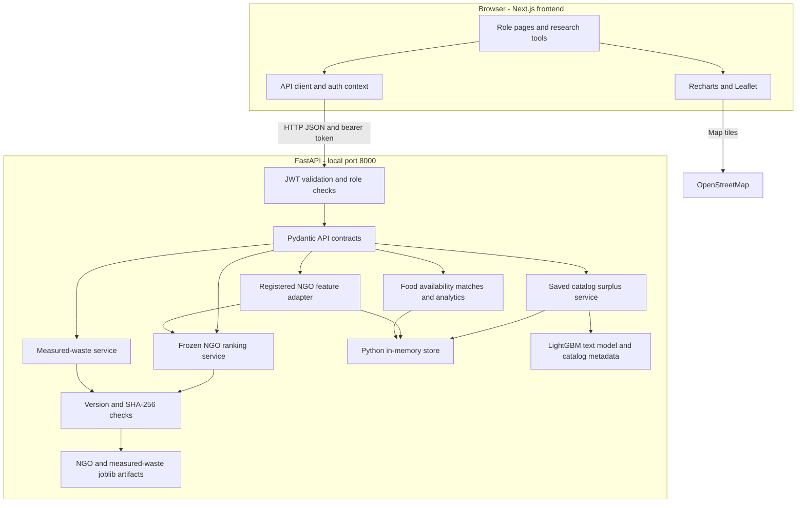

The database is currently a Python singleton of dictionaries and lists, **not PostgreSQL, MongoDB or a persistent SQL database**. Restarting the backend resets operational state. Multiple server workers would each maintain independent state. Saved model files remain on disk.

The catalog surplus loader reads a LightGBM text booster, verifies its feature contract and exposes a model-file hash as a version identifier. The joblib research loaders additionally enforce exact numerical package versions and SHA-256 manifests. These are separate loading paths; the surplus service does not use the same complete integrity check as the research loaders.

### Module blocks

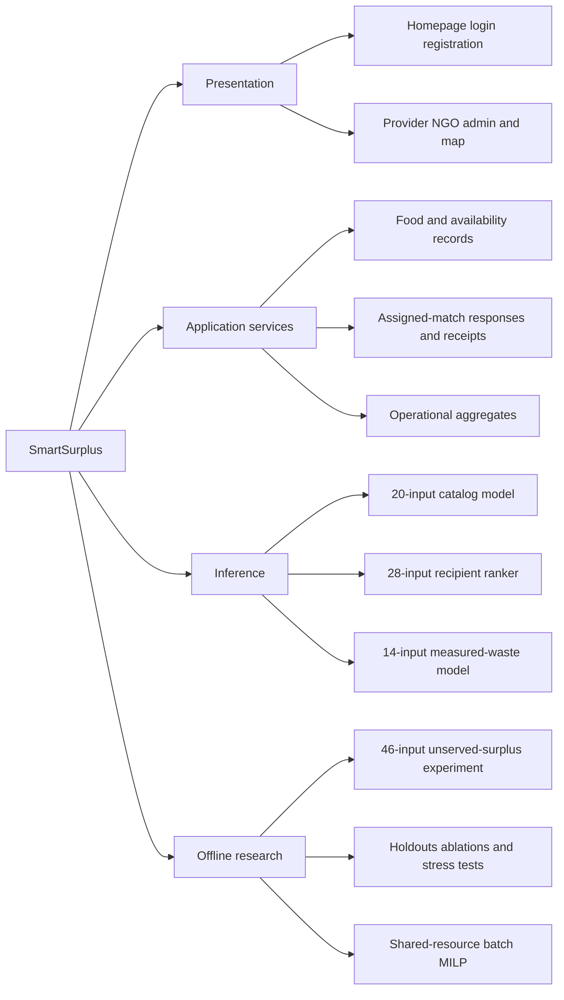

Detailed sequence, conceptual data-model and offline optimization diagrams are in [the architecture guide](docs/architecture.md). Every diagram labels the boundary between running application behavior and offline research.

## Use-case diagram

This use-case view maps the three implemented roles to application actions. Authentication is required for protected workspaces. Actor links show who initiates an action; they do not imply that every action is one automatic end-to-end transaction.

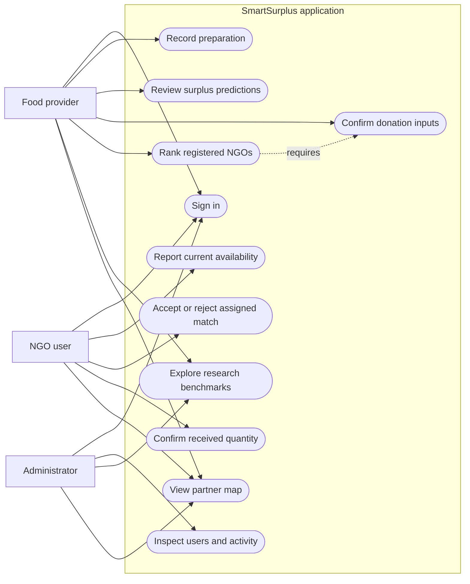

Reporting NGO availability changes what a provider can recommend. A recommendation does not automatically create an assigned match. The NGO response/receipt routes operate on separately existing match records; the current local UI can therefore correctly show an empty assigned-match list after a ranking demo.

## Processing blocks and data flow

### Provider preparation and surplus inference

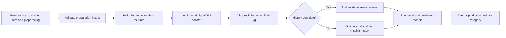

`POST /api/food-data` validates model compatibility before creating the food record and then saves a prediction. The local service reuses an existing prediction for the same food record rather than adding duplicates. Preparation logs without a catalog item are legacy fixtures; the bulk prediction route skips them.

### Confirmed donation and NGO recommendation

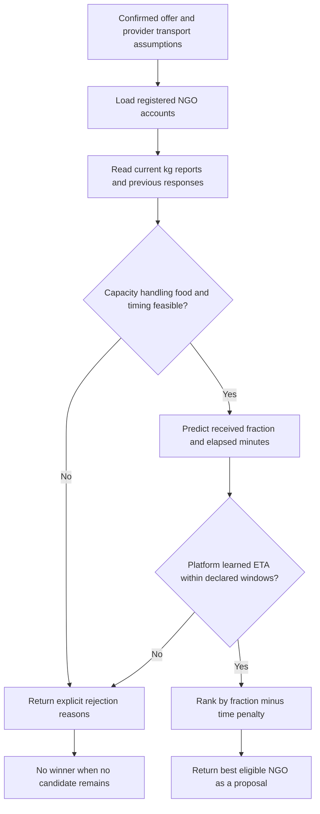

Candidates come from registered users on the server, not a client-supplied NGO list. New NGO accounts enter the directory but need current kg availability before they can be recommended. Reports older than 120 minutes are excluded. People/day account capacity is not converted into available kilograms.

## Modules and source map

Paths below identify the full local workspace. The publication checkout may contain only the subset described in the version note above.

| Module | Source path | Responsibility |
|---|---|---|
| Frontend routes | `frontend/src/app/` | Homepage, authentication, provider/NGO/admin pages and map |
| Shared UI | `frontend/src/components/` | AppShell, Sidebar, cards, icons, feedback and map |
| Browser auth and API | `frontend/src/lib/auth.tsx`, `api.ts` | Session context, local token storage, API calls and errors |
| Backend entry | `backend/app/main.py` | Route registration, CORS and health |
| Accounts and data | `backend/app/core/auth.py`, `database.py` | JWT, password hashing and in-memory fixtures |
| Operational surplus | `backend/app/services/prediction_service.py` | Saved model loading, inference, bounds and intervals |
| Operational features | `backend/app/ml/features.py` | Shared 20-input training/serving contract |
| Registered NGO adapter | `backend/app/services/platform_matching_service.py` | Registry profiles, real recorded response history and assumed travel |
| Ranking inference | `backend/app/services/ngo_ranking_service.py` | Frozen models, baseline policies, ranking and integrity checks |
| Candidate gates | `backend/app/ml/ngo_ranker.py` | Haversine, timing, ratios and hard eligibility rules |
| Availability/request schema | `backend/app/models/platform_matching.py` | Validated food, transport and NGO reporting inputs |
| Measured waste | `backend/app/services/measured_waste_service.py` | Separate Finnish benchmark and history-based inference |
| Model runtime | `backend/app/ml/model_runtime.py` | Reject incompatible joblib environments |
| Match lifecycle | `backend/app/api/ngo_routes.py` | Ownership checks, responses and receipt confirmation |
| Analytics | `backend/app/services/analytics_service.py` | Local receipt-based totals and offline model MAE |
| Model training | `backend/train_model.py`, `train_random_forest_compare.py` | Catalog training and separate full-data RF comparison |
| Paper experiments | `DataSet/research_v4/`, `ngo_matching_v1/`, `research_validation_v1/` | Research feature engineering, evaluation and optimization |

`backend/app/services/matching_service.py` also contains an older distance/urgency heuristic. It is not called by the current registered-NGO ranking route. Its formulas should not be described as the active learned matching policy.

### Directory overview

```text
capstone/
├── README.md
├── docs/
│   ├── architecture.md
│   ├── research/                 # Compact metrics, schema and provenance snapshots
│   └── screenshots/              # Actual built-in-browser captures and demo notes
├── frontend/
│   ├── src/app/                  # App Router pages
│   ├── src/components/           # Shared UI
│   ├── src/lib/                  # API/auth and typed domain contracts
│   └── public/                   # Local assets
├── backend/
│   ├── app/api/                  # FastAPI routes
│   ├── app/core/                 # Configuration, auth, process-local store
│   ├── app/models/               # Pydantic contracts
│   ├── app/services/             # Domain and inference services
│   ├── app/ml/artifacts/         # Saved models, catalog and experiment metadata
│   ├── tests/
│   ├── requirements-models.txt
│   └── start.ps1
├── DataSet/                      # Large local datasets and research sources
├── ResarchPaper/                 # Local manuscript work
└── output/                       # Local exports and reports
```

Source hashes for the inspected local implementation are recorded in [the implementation manifest](docs/implementation_manifest.json).

The large `DataSet/`, manuscript files, output archives and operational artifacts are not all present in the GitHub publication checkout. The documentation evidence bundle contains small summaries, not full raw data or a complete retraining archive.

## Models and datasets

### 1. Operational catalog surplus model

The current local provider screen loads a saved LightGBM model trained from synthetic item-day Parquet partitions. The catalog has 122 items, 12 cities, business/locality dimensions and item properties. The saved training record contains 12,356,298 item-day rows: 9,238,272 training, 1,566,291 validation and 1,551,735 test.

Chronological periods are October 2024–March 2026 for training, April–June 2026 for validation and July–September 2026 for test. Initial algorithm selection used a 5% sample, followed by full-training-period fitting of the selected LightGBM. Ten percent of training rows have the history bundle masked to exercise missing-history behavior. The later full-data RF comparison is an additional benchmark after the original LightGBM test had been evaluated.

The target is catalog `surplus_kg`, described by its comparison record as **post-reuse, pre-disposal**. It must not be substituted for the paper experiment's separately defined pure unserved-surplus target.

All 20 inputs are:

```text
quantity_kg, carry_in_kg, forecast_kg,
historical_avg_consumption, historical_28day_consumption,
item_id, city_id, venue_type_id, locality_type_id,
shelf_life_hours, unit_weight_kg, base_price_inr,
dow, month, day_of_month, is_weekend,
lag1_sold_kg, lag7_sold_kg, roll7_surplus_rate, roll28_surplus_rate
```

The UI receives catalog properties from the model metadata rather than asking the user to supply every feature manually. Item-unit quantities are converted to kg in the training feature builder. Missing optional history is preserved; the code does not invent measured historical observations.

### 2. Paper unserved-surplus experiment

The paper pipeline uses 60,000 synthetic item-services from 75 fictional providers, two tracked services/day over 400 days, plus 6,300 earlier warmup observations. It contains 18 menu items in Mumbai/Pune/Navi Mumbai scenarios. The 42,000/9,000/9,000 split is chronological; providers recur across partitions. Approximately 34.61% of the target values are zero.

The target is `actual_unserved_surplus_kg`. Nonlinear processes include provider differences, menu/calendar/weather/event effects, preparation buffers, stochastic demand, zero surplus and missing recorded predictors. Those generator mechanisms do not establish a percentage of real-world realism.

Its 46 inputs comprise:

- **8 categorical:** provider type, city, meal, item ID, food category, diet, storage and planned event type.
- **19 numeric base inputs:** calendar, prepared kg, expected customers, portion weight, prior consumption/surplus, weather forecasts, event size, preparation buffer, price, capacity and service duration.
- **10 transformations:** expected-demand kg, preparation-demand gaps and ratios, history comparisons and cyclic season encoding.
- **9 causal history summaries:** provider last/4/14-service utilization, variability and weighted utilization, zero-surplus share, city 150-service summaries and buffered observation count.

Histories use only services completed strictly before the prediction timestamp. Same-service actual consumption, actual demand, surplus and downstream donation outcomes are excluded. Numeric imputation and categorical encoding are fitted on training data only.

Three RF and eight LightGBM configurations were compared on validation. Selected RF uses 180 trees, depth 14 and minimum leaf size 8. The MAE-oriented LightGBM uses 600 trees, 15 leaves, minimum child samples 60, learning rate 0.035, L1 loss and lambda 12, with a mass-normalized target and mass weights. An RMSE-oriented choice is preserved separately. A selected blend has RF weight zero and is therefore just the selected LightGBM.

The original test had already been inspected and is labeled descriptive reuse. Seed 88421 supplies a fresh fictional population with 9,000 scored services after selection was frozen. It remains the same simulator family.

### 3. NGO ranking dataset and models

The main synthetic dataset contains 60,000 candidate rows: 6,000 offers × 10 NGO/courier alternatives, using 180 fictional NGOs. Whole offers remain grouped in chronological train/validation/test partitions of 42,000/9,000/9,000 candidate rows. Regressors fit eligible rows only: 14,089 training, 3,028 validation and 3,022 test candidates pass the modeled gates. Policy evaluation still retains complete offers, including unmatched cases.

Each family fits a **received-fraction regressor** and an **elapsed-minutes regressor**, using a training-fitted median imputer with missingness indicators. RF uses 140 trees, depth 14 and minimum leaf size 20. LightGBM uses 300 trees, 15 leaves, minimum child samples 50, learning rate 0.035 and lambda 8. Validation determines model/policy choices; the frozen default is LightGBM.

The 28 model predictors are:

```text
quantity_kg, route_distance_km, approach_minutes, queue_minutes,
travel_minutes, loading_minutes, unloading_minutes, ready_minutes,
pickup_remaining_minutes, delivery_remaining_minutes, open_minutes,
close_minutes, shift_remaining_minutes, report_age_minutes,
recipient_acceptance_rate, recipient_history_count,
courier_ontime_rate, courier_history_count,
rain_mm, temperature_c, traffic_index, demand_kg,
capacity_ratio, demand_ratio, nominal_elapsed_minutes,
deadline_slack_minutes, required_cold, required_hot
```

Additional validated fields, such as category, diet, coordinates and accepted storage, drive gates and feature construction. They are not all direct numeric model inputs. Historical NGO response rates use earlier recorded response timestamps in the platform adapter. Missing recipient/courier histories remain missing with count zero; they are not replaced by fabricated success records.

Before scoring, gates check quality confirmation, accepting status, food/diet compatibility, NGO and transport storage, available kg, vehicle kg, report age, pickup deadline, receiving hours and delivery/shift windows. The platform additionally excludes learned ETAs outside declared windows. The generic research snapshot route reports the learned-ETA warning separately.

The service considers all registered NGOs in inference batches of at most 100 and combines them before selecting the best eligible score. No feasible candidate means no recommendation. The best NGO may not be the nearest.

### 4. Measured datasets

| Source | Records and predictors | Evaluation use | Boundary |
|---|---|---|---|
| Finnish secondary school | 155 dated days, 14 inputs | 20 history / 80 train / 25 validation / 30 test | Combined kitchen + serving waste, not pure unserved donation |
| LaDe-D Jilin parcel subset | 31,357 retained deliveries, 9 inputs | 22,880 train / 7,390 validation / 1,087 test | Parcel acceptance-to-completion, not food-route time |

The Finnish model uses menu/calendar and earlier waste/diner histories. Same-day diners, plate waste and waste-per-diner are excluded. One missing label in warmup remains missing. Test dates are 3 March–11 April 2025; the last 20 days include an intervention. Rolling one-day-ahead forecasts may use earlier completed test days with fixed model parameters.

The parcel target includes queue/batch effects. Its negative test R² and large errors limit usefulness. It is not transferred into the live NGO ranking travel estimator. Neither measured dataset supplies the full provider-surplus/recipient-capacity/transport/receipt evidence needed to validate this application in the field.

Dataset inventory, export hashes and full research CSV field definitions are provided in [the research evidence directory](docs/research/README.md). The existing local CSV archive is `output/SmartSurplus_Data_Used_CSV.zip`; it covers the smaller research datasets, **not** every item-day row of the operational catalog corpus.

## Formulas and their implementation

### Surplus quantities and features

For the paper service target, the generator's bookkeeping is:

$$S=\max(P-C,0)$$

Here $P$ is prepared kg and $C$ consumed kg for the tracked service. The operational model has a different target and includes carry-in; its physical prediction bound is:

$$A=P+C_{carry},\qquad \hat S=\operatorname{clip}(f(x),0,A)$$

Implemented in `backend/app/services/prediction_service.py`, function `estimate`. Surplus risk is based on $\hat S/A$: low below 0.2, medium from 0.2 through 0.4, and high above 0.4.

In `DataSet/research_v4/features.py`, expected demand and prior utilization are:

$$D_{expected}=N_{expected}\times w_{portion},\qquad U_{past}=\frac{C_{past}}{P_{past}}$$

The same module constructs preparation gaps, ratios and seasonal sine/cosine features. For fractional L1 training, `DataSet/research_v4/improve.py` forms $z_i=S_i/P_i$ and weights absolute fraction errors by prepared mass, so the corresponding objective measures kg error.

### Distance, travel and timing

`backend/app/ml/ngo_ranker.py` implements Haversine distance with Earth radius 6,371 km. `platform_matching_service.py` then estimates:

$$d_{road}=k\,d_{straight},\qquad t_{travel}=60\frac{d_{road}}{v}I_{traffic}$$

Defaults are $k=1.3$, $v=20$ km/h and traffic index 1. Default rainfall 0 mm and temperature 25°C are explicit assumptions, not live weather. Provider-arranged transport starts at the provider, with approach time zero.

The candidate builder calculates:

$$t_{pickup}=\max(t_{ready},t_{courier}+t_{approach})$$

$$t_{nominal}=\max(t_{open},t_{pickup}+t_{load}+t_{travel}+t_{unload})$$

$$slack=\min(t_{deadline},t_{close},t_{shift})-t_{nominal}$$

These times are minutes relative to the decision timestamp. Capacity ratio and demand ratio divide reported kg by confirmed offer kg. Declared windows are operational constraints, not estimates of biological spoilage.

### NGO score and received mass

`backend/app/services/ngo_ranking_service.py` implements:

$$r_j=\operatorname{clip}(\hat f_j,0,1)-0.001\max(\hat t_j,0)$$

$$\widehat Q_{received,j}=Q_{confirmed}\operatorname{clip}(\hat f_j,0,1),\qquad j^*=\arg\max_{j\in\mathcal F}r_j$$

$\mathcal F$ is the eligible candidate set. The coefficient 0.001 is a fixed time preference, not a learned probability. The displayed platform ETA is the larger of nominal elapsed time and the model estimate. Ties are resolved using nominal elapsed time and candidate ID.

### Uncertainty and evaluation

The local catalog trainer calculates the 90th percentile of absolute validation error, $q$, and displays $[\max(0,\hat S-q),\min(A,\hat S+q)]$ when all history fields are present. This is an empirical **synthetic validation-error interval**; nominal 90% coverage is not a field guarantee. Missing history suppresses the interval.

$$MAE=\frac1n\sum_i|y_i-\hat y_i|,\quad RMSE=\sqrt{\frac1n\sum_i(y_i-\hat y_i)^2},\quad R^2=1-\frac{\sum_i(y_i-\hat y_i)^2}{\sum_i(y_i-\bar y)^2}$$

Matching evaluates received share $100\sum Q_{received}/\sum Q_{offered}$, retaining unmatched offers in the denominator. A change from 50% to 55% is five **percentage points**. These metrics are implemented in the training/evaluation scripts, not inferred from chart appearance or a confidence label.

## Evaluation results

### Operational catalog experiment

The saved local results use the full 1,551,735-row synthetic test period. The RF comparison was added after the original LightGBM evaluation, with the same inputs/periods and fixed configurations; it is not a new untouched model-selection study.

| Method | MAE kg | RMSE kg | R² |
|---|---:|---:|---:|
| Historical-consumption baseline | 1.6957 | 3.9181 | -0.0244 |
| Random Forest, later full-data comparison | 1.2227 | 2.5738 | 0.5579 |
| LightGBM, local serving default | 1.2106 | 2.6326 | 0.5375 |

The saved empirical interval covers 90.12% of this synthetic test. Risk-category agreement is only 49.27%; interval coverage and risk agreement are different metrics. See [the exact catalog summary](docs/research/operational_catalog_summary.json).

The current local default remains LightGBM. This catalog benchmark has a different target and data-generation process from the 60,000-service paper study. Model performance cannot be compared across those datasets as if only the algorithm changed.

### Paper surplus: fresh seed 88421, 9,000 services

| Method | MAE kg | RMSE kg | R² |
|---|---:|---:|---:|
| Training median | 2.0406 | 3.3965 | -0.0760 |
| Random Forest | 1.9330 | **2.8946** | 0.2185 |
| LightGBM, MAE-selected | **1.7852** | 3.0541 | 0.1300 |
| LightGBM, RMSE-selected | 1.9222 | 2.9036 | 0.2136 |

Across ten baseline simulator populations, full-history LightGBM mean MAE is 1.894 kg, descriptive 95% seed-bootstrap interval [1.819, 1.966], versus RF 2.044 [1.969, 2.115]. The paired MAE advantage is 0.150 kg [0.133, 0.166]. LightGBM mean R² is only 0.1367; improved MAE does not imply high explanatory power or deployment readiness.

The broader fixed-model evaluation scores 198,000 surplus rows across 22 conditions. Feature ablations and missing-history, missing-forecast, demand-shift and high-noise tests examine failure modes. Surplus stresses have only three seeds each; intervals describe simulation-seed variation, not field uncertainty.

### NGO policies: simulated received share

| Policy | Chronological 900-offer test | Fresh 1,000-offer test |
|---|---:|---:|
| Nearest feasible | 53.11% | 51.91% |
| Earliest feasible | 53.40% | 52.39% |
| History-demand | 56.84% | 57.69% |
| Random Forest | 56.77% | 58.17% |
| LightGBM | 57.06% | 58.60% |

All listed policies share the modeled gates. They leave 116 and 121 offers unmatched respectively, with zero recorded modeled constraint violations. That is a simulation implementation check, not a real food-safety rate.

Ten-seed baseline comparison gives LightGBM versus nearest-feasible **+5.732 percentage points**, interval [4.891, 6.587]. Versus RF, the difference is only +0.193 points [-0.247, 0.645], so the repeated comparison does not establish a reliable family winner. The full matching stress evaluation covers 24,000 offers.

### Measured school waste: 30 test days

| Method | MAE kg/day | RMSE kg/day | R² |
|---|---:|---:|---:|
| Random Forest | 5.3300 | 5.8139 | -0.6309 |
| LightGBM | 4.1592 | 4.9641 | -0.1890 |
| Training median | 3.7813 | 4.7357 | -0.0820 |
| Past-five-day mean | **3.3614** | 4.7522 | -0.0896 |

Validation selected LightGBM, but simple baselines perform better on test. Both trees have negative overall test R². The default is not retroactively changed using test performance. These limitations are retained rather than presented as successful validation of the unserved-surplus model.

The separate real parcel-time test gives LightGBM MAE 121.50 minutes and R² -0.0361 versus RF 123.45 minutes and -0.0442. It improves on its stated median baselines but remains a weak cross-domain result.

### Offline batch allocation

A separate SciPy MILP experiment allocates whole offers jointly across shared NGO capacity, courier schedules and discrete departure options. It evaluates 120 small cases, ten offers/four NGOs per case, three couriers normally and one under shortage, within 180 minutes. Jobs return to a common donor hub.

MILPExpected minus GreedyExpected received-share effects are +15.084 points [7.824, 22.679] normally, +8.438 [3.876, 13.026] with courier shortage and +2.422 [-0.100, 5.270] with tight NGO capacity. The last interval crosses zero. Of 240 operational/hindsight solves, 239 report successful solver status; maximum reported relative gap is 0.018953. Do not describe every solve as an exact optimum.

This scheduler is offline research, not a live reservation or online routing service. See [the architecture guide](docs/architecture.md#offline-batch-optimization) and [validation evidence](docs/research/README.md).

## Real browser demo

Captures were made on **1 November 2026** in ChatGPT's built-in browser against the local workspace. Form values used for demonstration are illustrative inputs, not newly collected field observations. No DOM values, screenshots or model outputs were edited to manufacture a result. Full-page captures preserve longer screens; viewport captures show key results.

### Sign-in

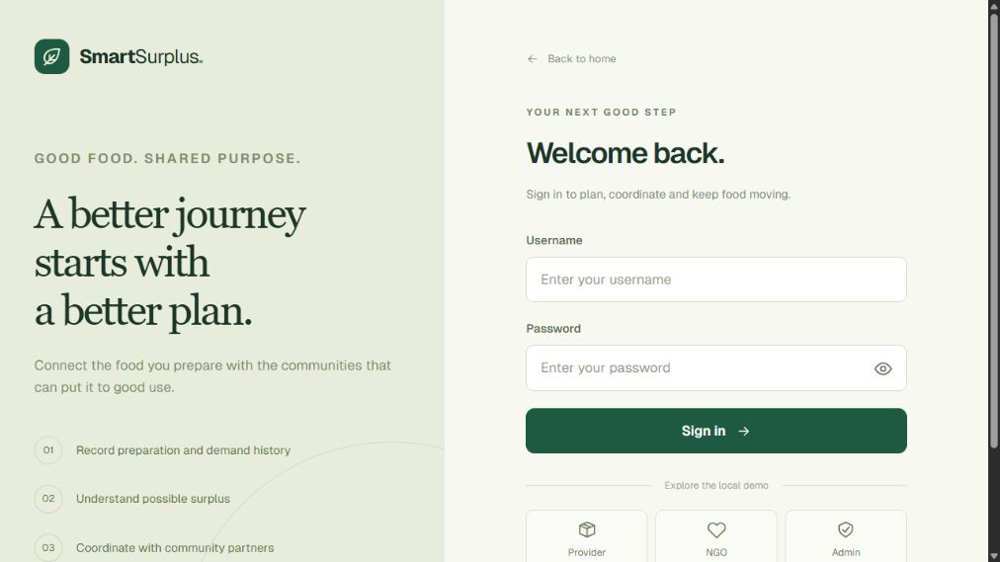

Role buttons fill the seeded demo credentials; the user still selects Sign in. The backend supplies a JWT and enforces role permissions on protected endpoints.

### Food entry and model output

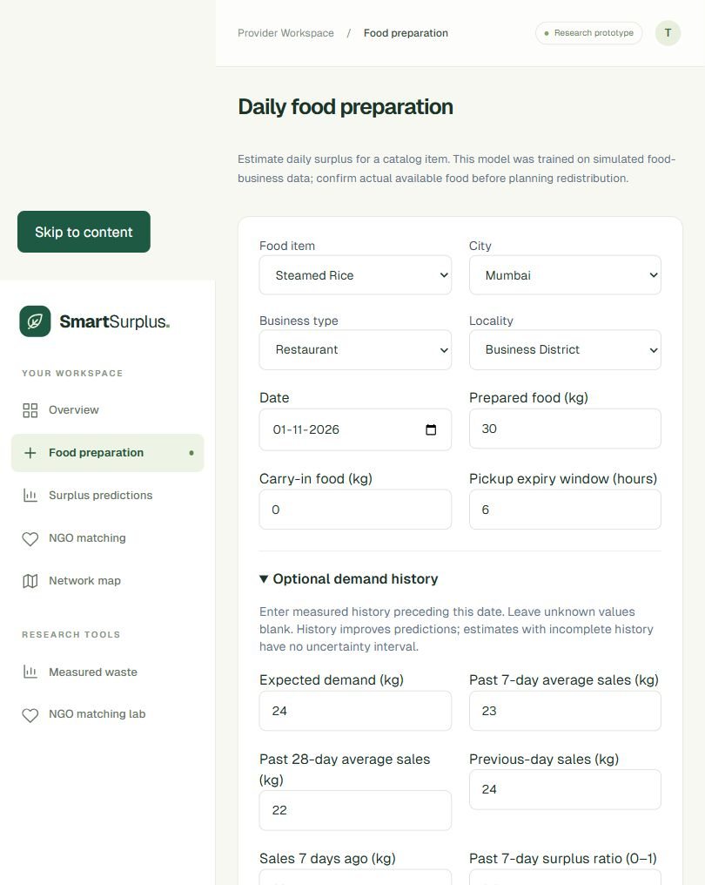

The captured example uses Steamed Rice, 30 kg prepared, no carry-in, expected demand 24 kg, prior 7/28-day averages 23/22 kg, previous-day/week sales 24/23 kg and prior surplus ratios 0.20/0.22. These history values were entered as a demo scenario.

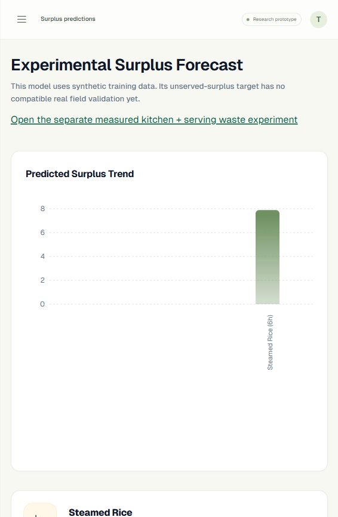

The running model returned **7.886 kg**, a displayed empirical interval of **5.17–10.60 kg**, and medium risk. These are outputs for one input scenario, not test-set accuracy or a confirmed donation quantity.

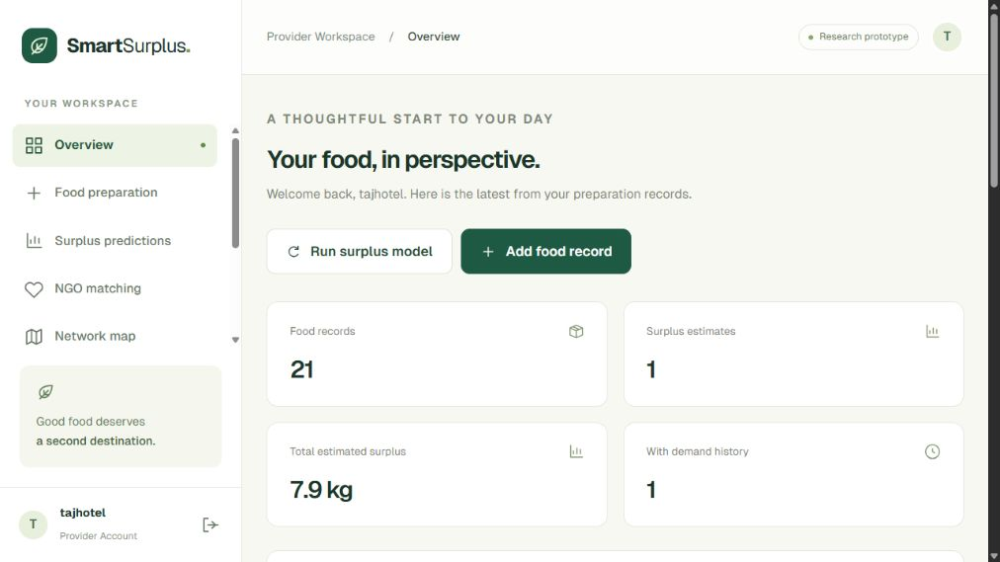

### Registered NGO recommendation

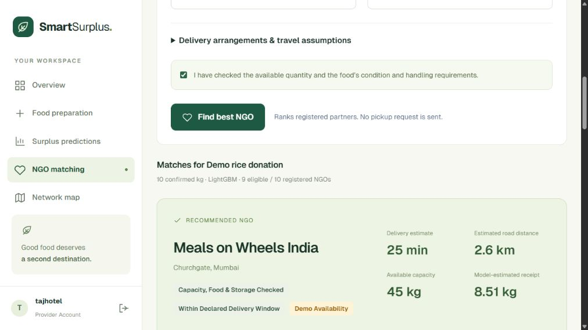

A separate confirmed 10 kg vegetarian grain offer with ambient handling and a 120-minute delivery window produced nine eligible NGOs out of ten seeded accounts. The captured default LightGBM proposal recommended Meals on Wheels India: approximately 25 minutes, 2.6 estimated road km, 45 kg reported demo capacity and 8.51 kg estimated receipt. This is a seeded demo proposal, not evidence that this organization received food or is a verified partner.

The complete candidate/form view is available in the [full matching capture](docs/screenshots/06-ngo-matching-full.jpg). Recommendation responses explicitly declare that allocation is not reserved and food safety is not validated.

### Measured-waste and matching research

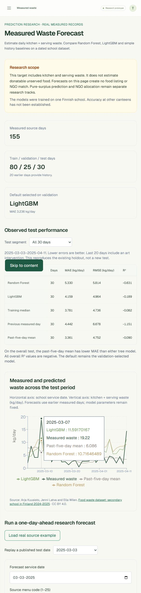

The source-school replay for 3 March 2025 returned 4.340 kg/day versus the preserved 2.050 kg observation. The page also retains the full test/baseline comparison and its limitations.

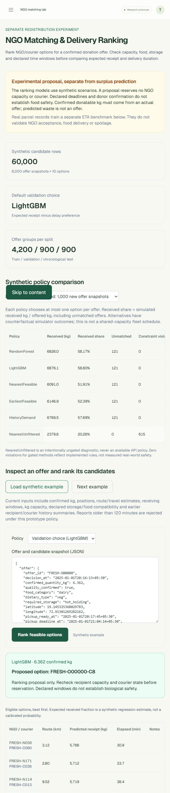

The first preserved synthetic example selects candidate `FRESH-O00000-C8`; incompatible storage options are explicitly rejected. Synthetic research IDs are distinct from platform account identities.

### NGO availability, network and administration

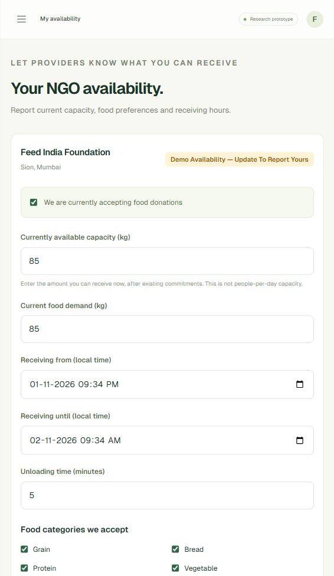

Available kg, categories, storage and receiving hours are explicit and separate from people/day capacity. This capture shows the labeled seed report, not a field-verified NGO declaration.

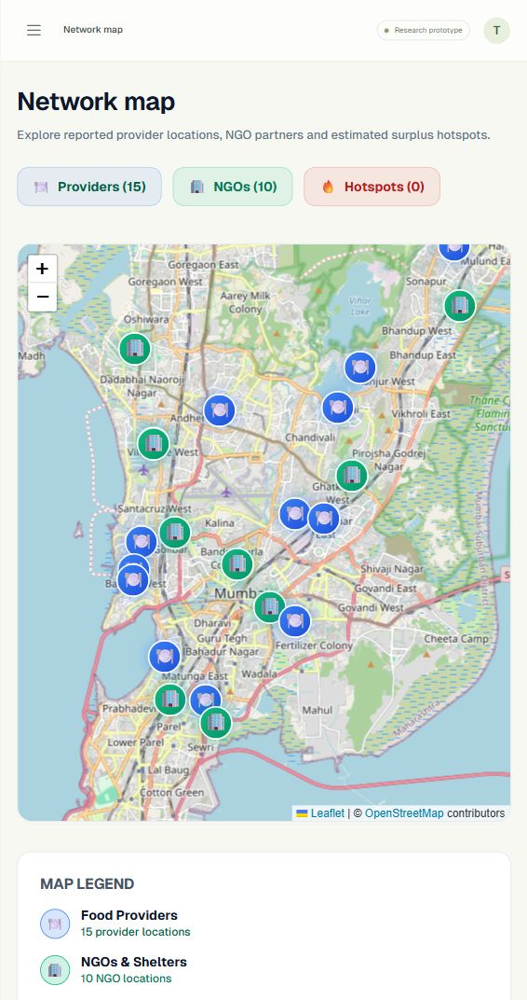

The map renders stored fixture coordinates with OpenStreetMap attribution. It is not a live vehicle-tracking screen.

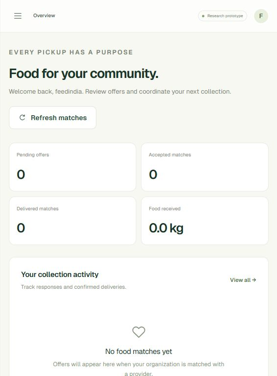

The empty assigned-match state is correct: a ranking proposal did not create an assignment or delivery.

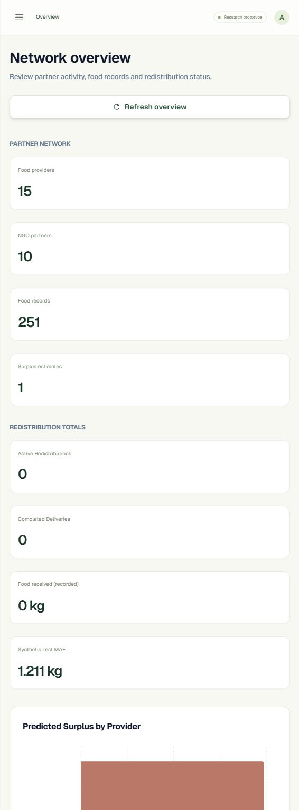

The administrator sees 251 food records after the single demo submission, one estimate and zero completed deliveries. Synthetic test MAE is labeled separately from operational totals.

Capture paths, route meanings and exact demo actions are indexed in [the screenshot guide](docs/screenshots/README.md).

## Installation and configuration

### Stack and prerequisites

- **Frontend:** Next.js 14.2.35, React 18, TypeScript 5, Tailwind CSS 3.4, Recharts, Leaflet and OpenStreetMap.
- **Backend:** Python 3.12, FastAPI, Uvicorn, Pydantic, python-jose JWT and passlib/bcrypt.
- **Models/data:** LightGBM, scikit-learn, NumPy, pandas, SciPy, joblib and PyArrow.
- **Local persistence:** process-local Python structures, plus saved model/metadata files.
- Use Node.js 20 LTS/npm and two terminals. Initial installation and map tiles require internet access.

### Backend: Windows PowerShell

From the project root:

```powershell
py -3.12 -m venv backend/.venv
backend/.venv/Scripts/python.exe -m pip install -r backend/requirements.txt
./backend/start.ps1
```

`start.ps1` validates the research model runtime and starts on `127.0.0.1:8000`. Optional flags: `-Reload` or `-Port 8001`. It uses `backend/.venv`, not the older `backend/venv` folder.

### Backend: Linux/macOS

```sh
python3.12 -m venv backend/.venv
backend/.venv/bin/python -m pip install -r backend/requirements.txt
cd backend
.venv/bin/python -m uvicorn app.main:app --host 127.0.0.1 --port 8000
```

### Frontend

In a separate terminal:

```sh
cd frontend
npm ci
npm run dev
```

Set `frontend/.env.local` if needed:

```dotenv
NEXT_PUBLIC_API_URL=http://localhost:8000/api
```

Open [SmartSurplus](http://127.0.0.1:3000), [interactive API docs](http://127.0.0.1:8000/docs) and [health](http://127.0.0.1:8000/health). A healthy process does not prove every model loaded successfully; inspect model-info/research-info endpoints too.

The full local catalog UI needs `surplus_model.txt`, `metrics.json` and `catalog.json` under `backend/app/ml/artifacts/`. Frozen NGO and measured-waste services need their corresponding model/metadata/manifest directories. Do not assume installing dependencies regenerates missing artifacts or the large training data.

### Numerical runtime and configuration

The joblib research environment is pinned to NumPy 2.1.3, pandas 2.2.3, SciPy 1.14.1, scikit-learn 1.5.2, joblib 1.4.2 and LightGBM 4.6.0. These are in `backend/requirements-models.txt`. The operational LightGBM artifact is a native text booster; its original training metadata records a different training environment. Training environments and serving formats should not be conflated.

Backend settings read `backend/.env` when run from the backend directory. `SECRET_KEY`, `ALGORITHM` and `ACCESS_TOKEN_EXPIRE_MINUTES` control JWT signing and expiry. Replace the demo signing key for deployment. CORS currently allows localhost and 127.0.0.1 on port 3000. The current map needs no Google Maps API key.

For a production-mode local frontend preview, run `npm run typecheck`, `npm run build`, then `npm start`. Rebuild after changing `NEXT_PUBLIC_API_URL`. This preview does not make the backend production-ready.

### Demo accounts

| Role | Username | Password |
|---|---|---|
| Provider | `tajhotel` | `pass123` |
| NGO | `feedindia` | `pass123` |
| Administrator | `admin` | `admin123` |

These are intentionally public local-demo fixtures. NGO reports become stale after two hours; update availability from the NGO account before a long demonstration. Restarting the API resets all operational changes.

## API guide

Protected endpoints use `Authorization: Bearer <token>`. Interactive request schemas at `/docs` are authoritative for the running version.

| Method | Endpoint | Purpose / role |
|---|---|---|
| GET | `/health` | Process/store health |
| POST | `/api/register`, `/api/login` | Accounts and JWT |
| GET / POST | `/api/food-data` | Provider food records |
| GET | `/api/model-info` | Local operational model/catalog metadata |
| GET / POST | `/api/predictions`, `/api/predict` | Read predictions / run missing supported predictions |
| GET | `/api/provider/ngo-matching` | Provider: registered NGO directory |
| POST | `/api/provider/ngo-matching/rank` | Provider: rank confirmed offer against registry |
| GET / PUT | `/api/ngo/availability` | NGO: own reported availability |
| GET | `/api/ngo/matches` | NGO: assigned matches |
| POST | `/api/ngo/accept`, `/api/ngo/confirm` | NGO: response and receipt |
| GET | `/api/admin/stats`, `/users`, `/logs` | Admin-prefixed aggregates, users and logs |
| GET | `/api/admin/food-data`, `/predictions`, `/matches` | Admin-prefixed global records |
| GET | `/api/map/providers`, `/ngos`, `/hotspots` | Map-prefixed authenticated data |
| GET | `/api/research/waste/info`, `/benchmark`, `/example` | Waste-research-prefixed metadata, results and example |
| POST | `/api/research/waste/forecast` | Provider/admin: KSW forecast |
| GET | `/api/research/ngo-matching/info`, `/example` | NGO-research-prefixed metadata and example |
| POST | `/api/research/ngo-matching/rank` | Provider/admin: explicit research snapshot ranking |

Abbreviated endpoints in grouped rows extend the prefix indicated in the purpose column; they are not root-level routes. The prediction row uses GET for `/predictions` and POST for `/predict`.

### Example confirmed-offer payload

Authenticate as a provider and POST this JSON to `/api/provider/ngo-matching/rank`:

```json
{
  "food_name": "Demo rice donation",
  "confirmed_quantity_kg": 10,
  "quality_confirmed": true,
  "food_category": "grain",
  "dietary_type": "veg",
  "required_storage": "ambient",
  "pickup_within_minutes": 120,
  "delivery_within_minutes": 120,
  "vehicle_capacity_kg": 30,
  "transport_storage": ["ambient"],
  "method": "LightGBM"
}
```

The server creates candidates from the registry. An optional `food_id` must belong to the requesting provider and limits the offered quantity to the recorded prepared/carry-in amount. Quality confirmation here is a user assertion, not automated certification.

Expected outcomes include `proposal_only` with a recommended NGO or `no_feasible_candidate` with rejection reasons. Both are valid responses. `401` indicates a session problem, `403` a role/ownership failure, `422` invalid input and `503` unavailable/incompatible research artifacts. The local receipt route additionally uses `409` when delivery confirmation is attempted before acceptance.

## Testing and reproducibility

### Application checks

```powershell
backend/.venv/Scripts/python.exe -m pip install -r backend/requirements-training.txt
backend/.venv/Scripts/python.exe -B -m unittest discover -s backend/tests -p 'test_*.py' -v
```

Frontend checks:

```sh
cd frontend
npm run typecheck
npm run build
```

Some full-workspace backend tests require local research inputs. The publication subset has fewer tests/data dependencies. Report results for the checkout actually tested rather than combining test counts from different versions.

Checks cover exact research-runtime validation, saved inference parity, role/ownership restrictions, registry identities, missing/stale availability, capacity/handling/time exclusions, empty and over-100 directories, and proposal operations that do not mutate match records. They do not establish field accuracy.

### Research evidence and reconstruction

- Research artifact directories preserve trained models, metadata and integrity manifests.
- Frozen selections and source/export hashes are retained with the experiments.
- The research evidence bundle includes original metric CSVs, feature dictionary, dataset index and selection/validation records.
- All metrics here identify a target, population and unit. No model confidence or screenshot is substituted for test performance.
- Full retraining needs the original datasets, generators and training environments. Compact documentation snapshots are not a complete reproducibility release.
- Do not tune on an inspected test and then describe it as an untouched holdout.

### Troubleshooting

| Problem | What to check |
|---|---|
| Research runtime mismatch | Install pinned requirements into `.venv` and restart the process; loaded old modules can survive a pip change |
| Integrity-check failure | Restore exact trusted artifact bytes; do not bypass the manifest |
| Catalog/model-info missing | Check whether the running checkout includes the local operational service and its artifacts |
| All NGOs rejected | Read report freshness, kg, receiving times, food/diet/storage, transport and deadline reasons |
| New NGO not recommended | Enter coordinates and current kg availability from that NGO account |
| Empty NGO match list after ranking | Expected: ranking proposals do not create assigned matches |
| Data disappears | In-memory state resets with backend restart |
| Network/CORS error | Check API process, URL, port and permitted frontend origin |
| Map blank | Check tile/network access; a Google Maps key is not required |

## Scope and future development

The prototype demonstrates an inspectable forecasting-and-recipient-selection workflow, compares tree families and baselines, and tests explicit operational constraints. The current evidence supports a scoped simulation study and a software demonstration.

Material limitations are synthetic principal outcomes, target differences across datasets, modest research surplus R², weak measured-data tree results, approximate travel, self-reported availability and no verified temperature/food-safety process. Realistic-looking scenarios and high row counts do not establish 99% realism. A 90% synthetic interval is not 90% field accuracy.

Operational limitations include process-local persistence, no shared capacity reservation, no automatic assignment from ranking, no courier dispatch integration and incomplete lifecycle enforcement. The local confirmation route bounds received kg, requires accepted/picked-up status and persists receipt kg, but accept/reject transitions still need stronger guards. Admin local saved-kg totals use received kg; they are user-reported totals, not independently audited environmental impact.

The public registration schema allows selecting an admin role, and demo signing keys/credentials and browser-local token storage are unsuitable for unrestricted public deployment. Controlled administrator provisioning, secure sessions/secrets, HTTPS and monitoring are required before hosting real accounts.

Recommended next steps:

1. Align the application surplus target/input contract with the intended paper model, then package the exact serving artifact and provenance.
2. Add a persistent database, migrations and transactional assignment/reservation records.
3. Connect explicit provider confirmation, NGO acceptance, cancellation and bounded receipt measurements into one auditable lifecycle.
4. Collect compatible provider/item services: prediction timestamp, prepared kg, separately weighed unserved kg, expected demand and completed history.
5. Collect timestamped recipient/courier state, actual pickup/receipt times, received kg and handling evidence for prospective matching evaluation.
6. Freeze a field protocol and evaluate untouched dates/providers against simple baselines; report missingness, drift and uncertainty.
7. Add observed routes/ETA and test shared-resource allocation under concurrent/online arrivals.
8. Publish a license-reviewed reproducibility package containing generators, contracts, models, metrics and checksums.

## Team and references

**Group 5** — Riddhi Menghrajani: dataset construction; Ashutoshkumar Tripathi and Yahya Shaikh: model training and fine-tuning; Aman Yadav: frontend web development. **Mentor:** Dr. Mrs. Gresha Bhatia.

- Kuusisto, Latva and Wilén, [Finnish secondary-school food-waste dataset](https://zenodo.org/records/20825233), DOI [10.5281/zenodo.20825233](https://doi.org/10.5281/zenodo.20825233). Recorded source license: CC BY 4.0. This is externally measured data, not team-collected field data.
- Cainiao-AI, [LaDe-D](https://huggingface.co/datasets/Cainiao-AI/LaDe-D), related paper DOI [10.1145/3637528.3671548](https://doi.org/10.1145/3637528.3671548). Local source audit records Apache-2.0 for the dataset card; check source terms before redistributing raw files.
- Map attribution: [OpenStreetMap contributors](https://www.openstreetmap.org/copyright).

No repository-wide software license is introduced by this README. Source-dataset, dependency and map licenses are separate from the application's licensing status. Add an appropriate code license before promising unrestricted reuse.
