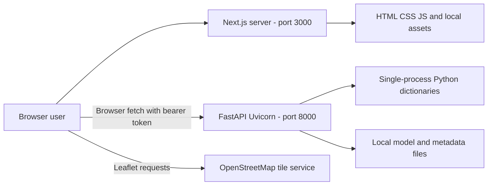
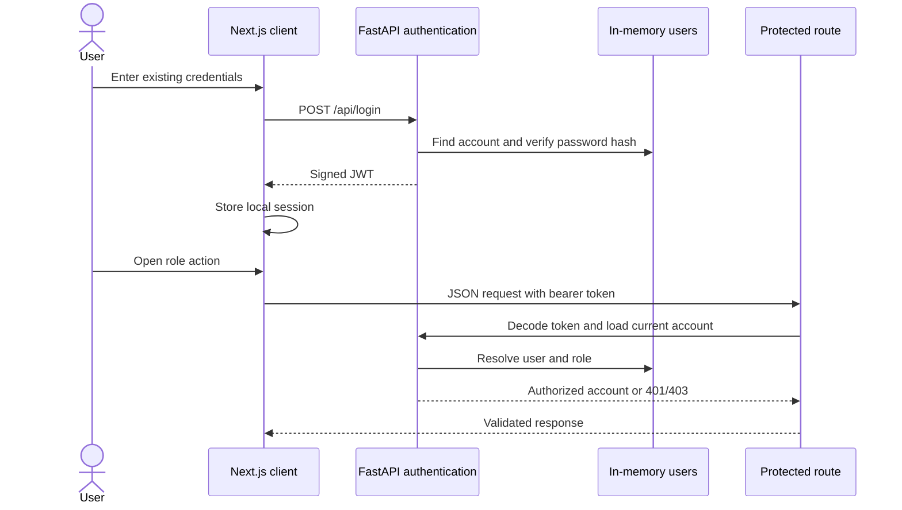
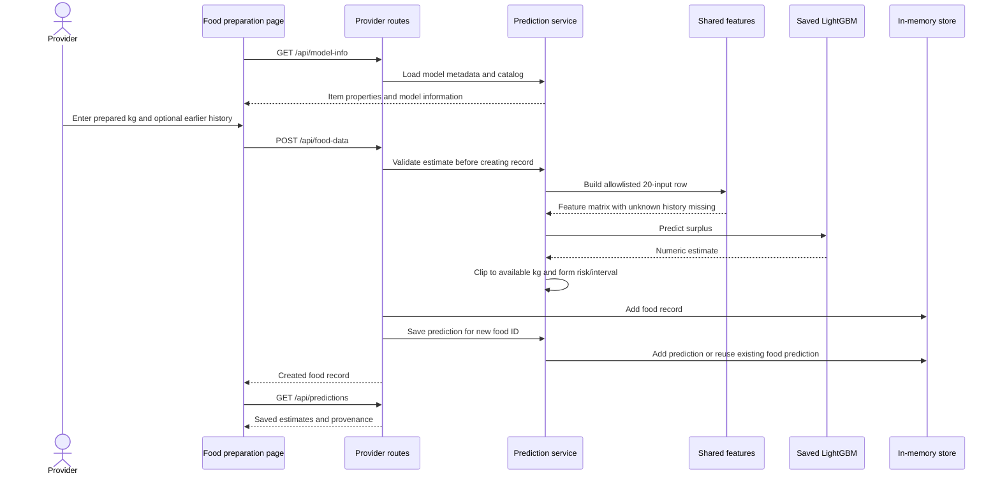
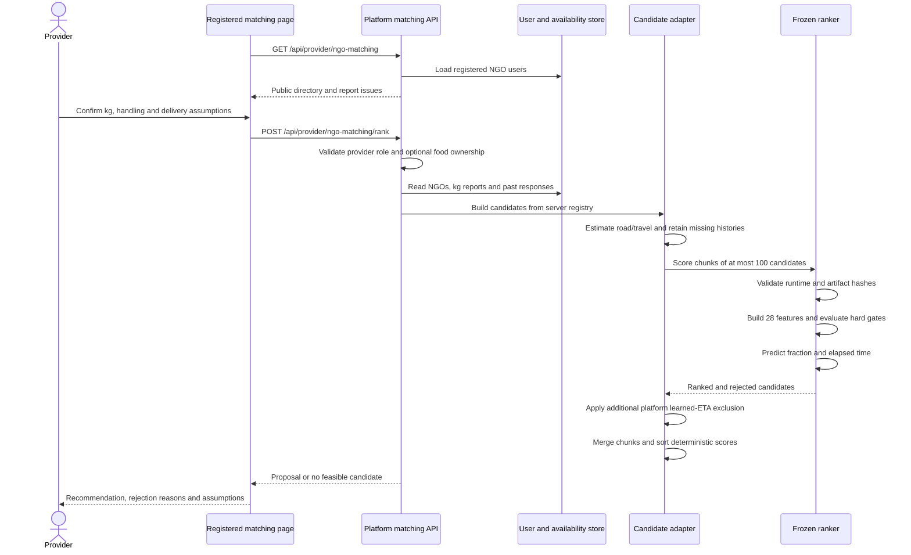
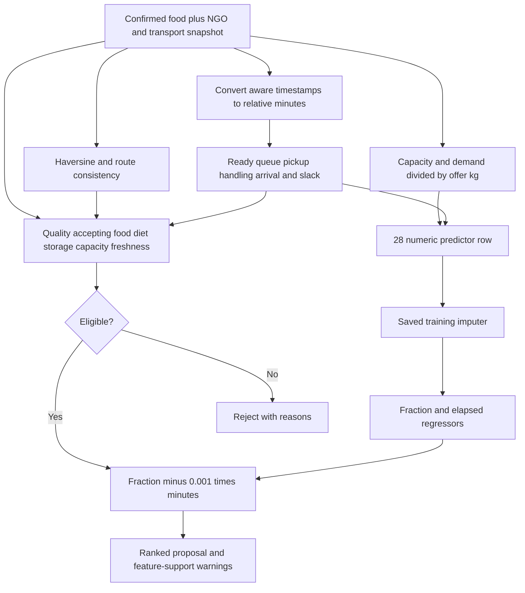
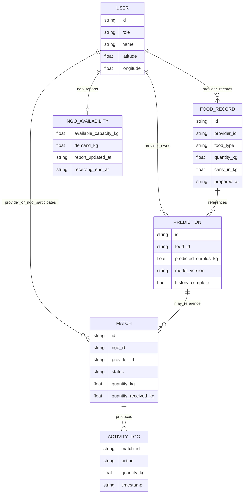
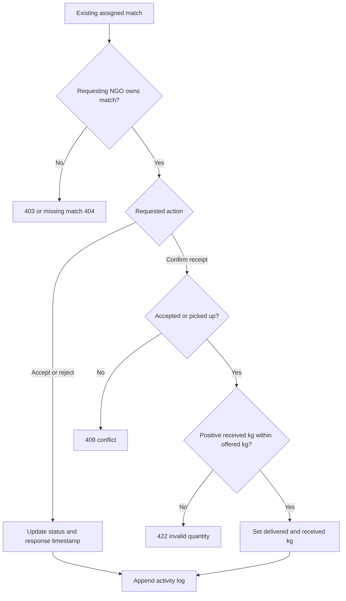
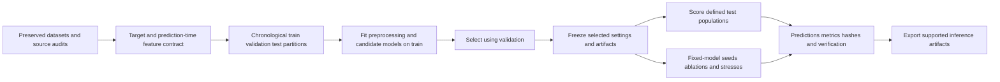
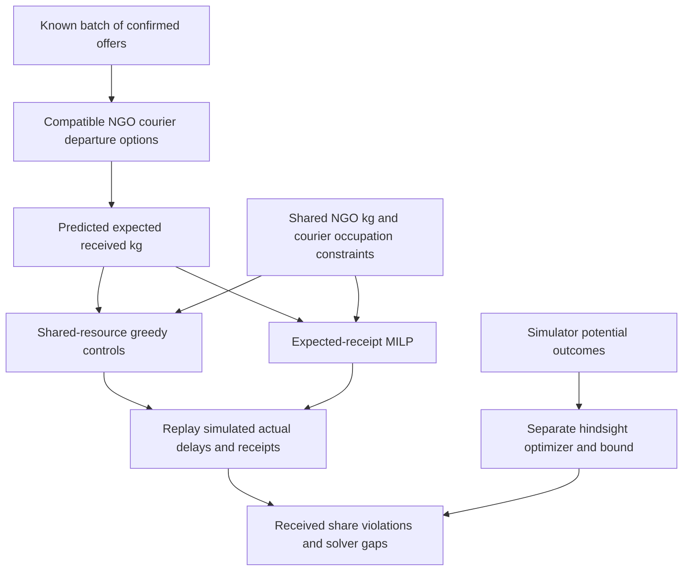

# Implemented architecture and diagrams

These diagrams describe the inspected **local workspace**, as of 1 November 2026. Read the [README version scope](../README.md#project-status-and-version-scope) before applying them to an older GitHub checkout. Solid arrows show implemented calls/data relationships; the offline research sections are explicitly separate from runtime operations.

## 1. Deployment blocks

There is no deployed SQL server, Redis, task queue, microservice cluster, external courier API or live GPS stream. The two local servers run independently. Backend CORS permits frontend origins on port 3000. The frontend API base is configurable; map tiles require external network access.

## 2. Authentication and request boundaries

UI redirects are navigation conveniences. Backend dependencies enforce role and ownership. Research routes permit provider/admin; availability updates require the NGO's own account. Registration currently permits selecting admin and must be restricted before public deployment. Browser-local token storage is a prototype choice.

## 3. Food entry and saved surplus inference

No model training occurs in this local inference request. The native text booster is loaded once through a cached loader. IDs, version, data source and history completeness accompany output. Missing history suppresses the validation-error interval. The separate paper experiment uses 46 inputs and does not replace this service merely by existing under `DataSet/`.

## 4. Registered NGO ranking sequence

The registry response omits passwords and private login credentials. The recommendation does not mutate food, predictions, matches or logs. It reports `allocation_reserved=false` and `food_safety_validated=false`. NGO response history uses earlier recorded timestamps; seeded availability is explicitly labeled demo data.

## 5. Candidate feature and gate blocks

The service builds/scans matrices for candidates, including candidates later excluded; final eligibility determines whether an option can be selected. Missing-feature counts and inputs outside training support are exposed as warnings. The generic research route permits explicit snapshots, while the platform route derives NGO identities and profiles itself.

## 6. Conceptual data relationships

This is a relationship model of the **in-memory objects**, not an existing SQL schema. User records represent provider/NGO/admin accounts; availability is nested in an NGO account.

Availability is currently available reported kg after commitments, not inferred people/day capacity. Forecast, confirmed offer, nominal match kg and received kg have different meanings. A stateless recommendation has no persisted MATCH identity. The local confirmation route records received kg on the match and in the activity log; analytics sums actual reported receipt for delivered records.

## 7. Implemented match response and receipt boundaries

This describes the current local route, not the older publication route. Accept/reject still lacks a complete transition-state guard. The `picked_up` status exists in the contract but there is no dedicated courier pickup transition endpoint in this workflow. Neither this diagram nor the status enum establishes a complete dispatch state machine.

## 8. Offline training and evaluation blocks

The operational catalog, 46-input paper surplus, NGO ranking, measured school waste and parcel time have separate contracts and result records. Public measured datasets do not automatically validate a synthetic model with a different target. The 46-input reused test is labeled previously viewed; the fresh seed and repeated simulations remain synthetic.

## Offline batch optimization

An assignment chooses one whole offer, NGO, courier and departure alternative. Constraints enforce at most one action per offer, sum of full reserved offer kg within each NGO capacity, non-overlapping nominal courier occupation, compatibility and windows. Jobs return to a common donor hub. This is a small fixed-batch study with discrete departures, not continuous route optimization or online dispatch. The app's registry ranking does not call this optimizer.

## Changes needed for a persistent deployment

The following are requirements, not implemented components in the runtime diagrams:

1. Persistent account/food/availability/assignment/receipt tables and migrations.
2. Atomic kg and courier reservations, expiry/cancellation and idempotent lifecycle transitions.
3. An explicit provider-to-NGO offer/accept workflow before pickup is arranged.
4. Controlled administrator provisioning and stronger session/secret management.
5. Measured routes, timestamped actual outcomes and field evaluation under a frozen protocol.
6. Auditable measurement definitions for prepared, unserved, offered, reserved, picked-up and received mass.
